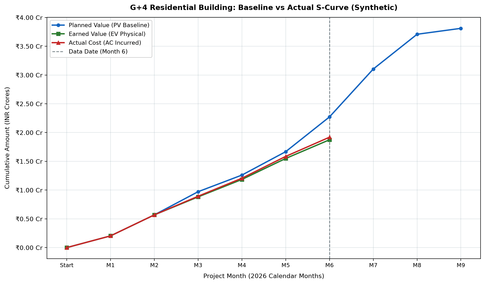
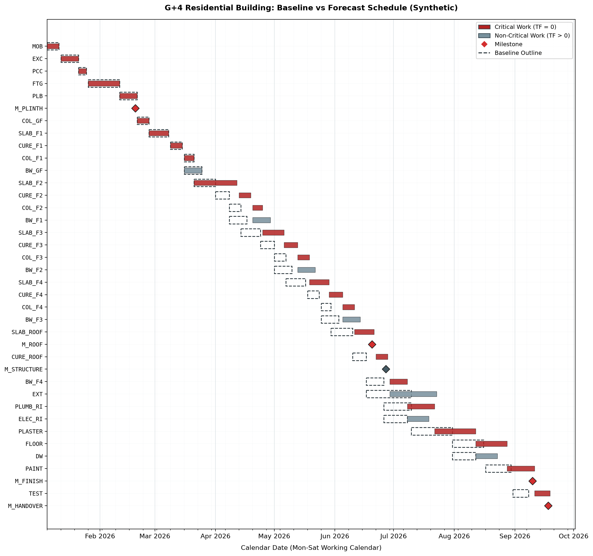

# Construction Project Control Dashboard: G+4 Residential Building (Synthetic)

This project tracks a synthetic G+4 residential building (2,000 sqm, 8-month baseline plan) at Month 6 (data date 30 Jun 2026). It covers CPM scheduling, EVM cost tracking, materials, contractor bills, and quality, with a 1-page report for the Regional Project Head, an Excel workbook, and a Streamlit dashboard. All data and project problems are synthetic, planted on purpose to test the control checks.

## What It Shows

The project control system directly supports standard project manager duties:
- Monthly progress, budget, and material reports: Generates a 1-page report for the Regional Project Head and an 8-sheet Excel workbook with live formulas from pipeline data.
- Identifying progress, cost, and quality issues: Evaluates automated early warning flags across 9 categories to surface critical delays, budget overruns, and quality exceptions.
- Following up on material quality and schedules: Tracks raw material inventories, 7-day concrete cube test records, rebar inspections, and forward purchase requirements.
- Monitoring milestones and acting on deviations: Compares baseline and forecast milestone dates, calculates working-day slippage, and prescribes operational recovery actions.
- Monitoring budget adherence: Tracks time-phased Planned Value, Earned Value, and Actual Cost, highlighting item-level cost variances against contract rates.
- Reporting to a regional project head: Delivers a 1-page report for the Regional Project Head covering performance indices, schedule drivers, material status, and financial exposure.
- Processing contractor payments: Manages Running Account (RA) bills, deducts 5% retention and 2% TDS, monitors payment certification timelines, and enforces payment holds.
- Reviewing QC inspection reports: Maintains an inspection register and non-conformance report (NCR) log, tracking resolution durations and open structural defects.

## How to Run

### Windows (Local Virtual Environment)
```cmd
python -m venv .venv
.venv\Scripts\activate
pip install -r requirements.txt
python -m src.pipeline
pytest -q
streamlit run app.py
python scripts/check_numbers.py --pdf outputs/report_month_06.pdf
python scripts/check_numbers.py --md README.md
```

### macOS and Linux
```bash
python3 -m venv .venv && source .venv/bin/activate && pip install -r requirements.txt && python3 -m src.pipeline && pytest -q && streamlit run app.py
```

## Method Summary

- CPM Scheduling: Models 38 activities linked by finish-to-start logic with zero lag on a 6-day working week (Monday through Saturday, Sundays off).
- Linear Planned Value: Spreads activity budgets linearly across planned working days, using cumulative integer rounding to match BAC exactly.
- EVM Actuals and Simulation: Measures progress by physical work placed, combining baseline rates with random noise on non-critical work and injected market price changes.
- Completion Forecasting: Calculates standard EAC (BAC / CPI) assuming historical cost performance continues, alongside combined EAC (AC + (BAC - EV) / (CPI x SPI)) for delay-induced escalation.
- CPM-Based Schedule Forecasting: Evaluates remaining durations from the data date through the network to identify true completion dates rather than relying on crude duration / SPI division.
- Early Warning Flags: Automates red and amber alerts across milestone slip, critical path progress, SPI, CPI, cost overruns, material deficits, aged NCRs, and pending bills.
- Material Quantification: Uses assumed coefficients to derive required quantities of cement, steel, sand, aggregate, and bricks from physical work progress.
- Contractor Payments: Simulates monthly progress bills matching incurred actual costs, applying 5% retention and 2% TDS deductions, with payment held during active quality disputes.
- Quality Control and NCRs: Coordinates site inspections (rebar, concrete cubes, slab level, masonry plumb), raising NCRs with resolution ageing metrics.

Detailed engineering formulas and methodology are documented in [docs/METHOD.md](docs/METHOD.md).

## Results at Month 6 (Synthetic)

### Performance Scorecard
| Metric | Baseline / Plan | Actual / Forecast | Variance / Deviation |
|---|---|---|---|
| Planned Value (PV) | Rs 2,27,18,667 | - | - |
| Earned Value (EV) | - | Rs 1,87,43,829 | - |
| Actual Cost (AC) | - | Rs 1,91,92,840 | - |
| Schedule Variance (SV) | - | - | -Rs 39,74,838 |
| Cost Variance (CV) | - | - | -Rs 4,49,012 |
| Schedule Performance Index (SPI) | 1.000 | 0.825 | - |
| Cost Performance Index (CPI) | 1.000 | 0.977 | - |
| Budget at Completion (BAC) | Rs 3,81,13,500 | - | - |
| Estimate at Completion (EAC) | - | Rs 3,90,26,515 | - |
| EAC Combined | - | Rs 4,32,32,468 | - |
| Variance at Completion (VAC) | - | - | -Rs 9,13,015 |
| To-Complete Performance Index (TCPI) | - | 1.024 | - |
| Project Completion Date (CPM) | 07 Sep 2026 | 18 Sep 2026 | +10 wd |
| Project Completion Date (Crude) | 07 Sep 2026 | 29 Oct 2026 | +45 wd |
| Warning Flags (Month 6) | - | 6 red, 2 amber | 8 total |
| Cumulative Retention Held | - | Rs 9,59,642 | - |
| Active Non-Conformance Reports | 0 | 1 open (NCR-003, 56 days) | - |
| Held Contractor Bills | 0 | 1 held (RA-05, 30 days) | - |

Schedule Performance Index (SPI) is 0.825 because the 10-working-day delay on SLAB_F2 pushed high-value finishing and service installations scheduled for late June past the Month 6 data date.

### Top 5 Priority Issues at Month 6
1. [RED] M_HANDOVER: Milestone forecast delay of 10 working days (also moves M_FINISH). Action: Recover on finishes: overlap plaster and flooring floor by floor or add a finishing crew; agree a revised handover date with the Regional Project Head.
2. [RED] Project: Project SPI (0.825) below 0.95 threshold. Action: Perform schedule variance root cause analysis and issue schedule recovery plan.
3. [RED] BW_F4: Critical activity BW_F4 is 75.0% behind baseline progress. Action: Re-plan the look-ahead; protect the remaining float; no extra crew unless the handover date must be held.
4. [RED] NCR-003: NCR NCR-003 unresolved for 56 days (>14 day limit). Action: Convene joint site inspection with contractor and structural consultant to approve rectification.
5. [RED] RA-05: RA bill RA-05 is held: open NCR on SLAB_F3 (slab level check failed). Action: Expedite NCR rectification and client sign-off to release payment certificate.

### What-If Sensitivity Analysis

#### Table 1: Steel Rate Uplift Sensitivity (SLAB_F2 Delay = 10 wd)
| Steel Uplift | Slab Delay | SPI | CPI | EAC (INR) | VAC (INR) | Forecast Handover | Delay |
|---|---|---|---|---|---|---|---|
| 5% | 10 wd | 0.825 | 0.988 | Rs 3,85,78,519 | -Rs 4,65,019 | 2026-09-18 | +10 wd |
| 10% | 10 wd | 0.825 | 0.977 | Rs 3,90,26,515 | -Rs 9,13,015 | 2026-09-18 | +10 wd |
| 15% | 10 wd | 0.825 | 0.966 | Rs 3,94,74,512 | -Rs 13,61,012 | 2026-09-18 | +10 wd |

#### Table 2: SLAB_F2 Schedule Delay Sensitivity (Steel Rate Uplift = 10%)
| Slab Delay | Steel Uplift | SPI | CPI | EAC (INR) | VAC (INR) | Forecast Handover | Delay |
|---|---|---|---|---|---|---|---|
| 5 wd | 10% | 0.865 | 0.978 | Rs 3,89,81,655 | -Rs 8,68,155 | 2026-09-12 | +5 wd |
| 10 wd | 10% | 0.825 | 0.977 | Rs 3,90,26,515 | -Rs 9,13,015 | 2026-09-18 | +10 wd |
| 15 wd | 10% | 0.809 | 0.976 | Rs 3,90,45,685 | -Rs 9,32,185 | 2026-09-24 | +15 wd |

## Tests

The project includes 71 automated tests across 15 test modules with zero failures:
- tests/test_app.py (1 test): Verifies headless execution of the Streamlit dashboard across multiple project months.
- tests/test_budget.py (3 tests): Verifies activity budget derivation, linear PV spreading, and BAC exact integer equality.
- tests/test_check_numbers.py (5 tests): Audits report text against data sources, catching invented numbers and validating Indian currency formats.
- tests/test_cross_check.py (3 tests): Independent verification running relaxation CPM, calendar walks, and first-principles EVM.
- tests/test_data.py (14 tests): Validates activity relationships, BOQ structures, rates, and calendar integrity.
- tests/test_evm.py (2 tests): Verifies EVM formulas and edge cases against independent hand-calculated benchmarks.
- tests/test_flags.py (10 tests): Tests threshold triggers and dynamic text generation across all early warning categories.
- tests/test_injected_issues.py (7 tests): Validates the specific effects of injected delays, price escalations, shortages, and holds.
- tests/test_materials.py (3 tests): Checks raw material requirement calculations, consumption tracking, and procurement buffers.
- tests/test_payments.py (3 tests): Tests RA bill calculations, retention and TDS statutory deductions, and payment status lifecycles.
- tests/test_quality.py (2 tests): Verifies quality inspection scheduling, pass rates, and NCR tracking logic.
- tests/test_report.py (7 tests): Confirms Excel formula references, formatting rules, and PDF single-page layout constraints.
- tests/test_schedule.py (5 tests): Tests forward and backward CPM passes, float calculations, and schedule forecasting.
- tests/test_sensitivity.py (4 tests): Tests monotonicity, base-case identity, and handover date calculations across sensitivity scans.
- tests/test_simulate.py (2 tests): Validates simulation monotonicity, physical progress bounds, and noise repeatability.

What each test suite group proves:
- Hand-checked unit tests: Confirm that core CPM, calendar, and EVM formulas match exact hand calculations.
- Invariants: Confirm non-decreasing cumulative EV/AC, progress bounded in [0, 1], and repeatable noise draws.
- Injected-issue tests: Confirm that injected events (slab delay, steel escalation, cement shortage, payment hold) trigger expected variances.
- Negative control: Proves that disabling injections results in zero red and zero amber warning flags, with SPI and CPI remaining at or above 0.95.
- Output checks: Verify that the Excel workbook contains valid dynamic formulas and that the PDF report fits exactly onto a single page.
- Independent cross-check: Re-implements CPM by relaxation and recomputes EVM from first principles to catch potential pipeline logic errors.
- Number tracing: Confirms that every number, currency value, percentage, and date in reports and documentation comes from data files.

## Limitations

- Synthetic data and assumed rates: All quantities, rates, and schedule durations are illustrative engineering estimates rather than actual project records.
- No real site: The model does not account for real-world environmental disruptions, weather events, or unforeseen site conditions.
- Linear cost spreading: Planned Value is distributed evenly across working days without S-curve loading within individual activities.
- Finish-to-start links only: The schedule does not incorporate start-to-start relationships, finish-to-finish links, lead/lag offsets, or resource levelling.
- Simple EAC formulas: Forecasts rely on standard index-based extrapolations (BAC / CPI and combined EAC) without discrete bottom-up reassessment.
- No quantity overruns: Physical work executed equals planned design quantities, isolating cost variances to unit price changes.
- Early start assumption: The contractor is assumed to commence every activity immediately upon predecessor completion.
- No link from stock to progress: A shortfall is flagged as a warning, but does not slow work in the simulation.
- Professional software: This synthetic system illustrates core engineering concepts and is not a replacement for enterprise tools like Primavera P6 or Microsoft Project.
- Injected issues: Operational challenges were introduced intentionally, and baseline background noise is kept small (+/-3%) by design.

## Screenshots & Project Artifacts

- EVM Performance S-Curve:
  

- Baseline vs Forecast Schedule Gantt:
  

- 1-Page Report for the Regional Project Head (PDF): [outputs/report_month_06.pdf](outputs/report_month_06.pdf)
- Multi-Sheet Excel Workbook: [outputs/workbook.xlsx](outputs/workbook.xlsx)
